# Design Phase Lifecycle and Design Collaboration in Discuss

Companion to *Architecture v3 (Frappe Suite First)* and *Construction Project Lifecycle and Branch Register*. This document expands stage **S4a Design** and shows how the **Discuss** module (Raven) carries design collaboration.

## 0. Scope and principles

- **Scope:** from design kickoff (after Mobilization) to the design-side checks of Gate A. Permits (S4b) are referenced where design and permits interact.
- **Chat is for conversation; records are for decisions.** Anything that changes design, cost, time or responsibility must be promoted from a chat thread into a record (RFI, Task, BCF Topic, Design Change Request, Design Decision). Unrecorded chat answers are not binding.
- **One thread per topic, anchored to a record where one exists.** A thread is the unit of discussion; the channel is only the routing.
- **Files live in Files (Drive), never in chat.** Chat shows a preview and a link.
- **Client visibility is explicit.** Nothing reaches the client room unless it was published there by an authorised role.
- **IDs:** DK kickoff, DC concept, DS schematic, DD development and coordination, DT technical documentation, DR reviews and comments, DX design change and value engineering, DB clashes (BCF), DI RFIs and submittals in design, DM meetings, DA client approval, DE external consultants, DF freeze and issue, DH discussion threads, DN notifications, DP access, DZ system failures.

### Raven capabilities this design relies on

| Status | Capabilities |
|--------|--------------|
| **Confirmed from Raven's published feature descriptions** | Workspaces with separate channel sets; open, public and private channels; direct messages; threads, inline replies, reactions; user mentions; polls; pinned messages; file and image sharing; document previews with customisable fields; **Document Alerts** (Jinja templates, conditions, sent to users or channels, with print and **workflow actions directly from chat**); messages linked to documents appear on the document timeline; Google Meet integration; search over messages, files, channels and users; AI agents; PWA with push notifications; supports Frappe v16 |
| **Unverified (spikes R1 to R8, section 12)** | Programmatic channel and thread creation; Website User (client or consultant) channel membership; custom message actions such as "promote to RFI"; mention groups; per-project channel targeting from a Document Alert; message edit history and deletion rules; archive-versus-delete behaviour; export and retention |

---

## 1. Design phase lifecycle

### 1.1 Master flow

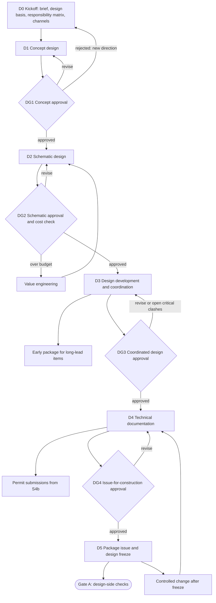

Cross-cutting loops that run inside D1 to D5 are drawn separately below: design change requests, review rounds, clash resolution, RFIs, meetings, client approval, consultant deliverables.

### 1.2 Stage reference

| Stage | Purpose | Main records | Channels most active | Exit gate | Typical owners |
|-------|---------|--------------|----------------------|-----------|----------------|
| **D0 Kickoff** | Confirm brief, design basis, naming convention, responsibility matrix, programme, channels | Design Stage, Project Document (brief), Task | `-general`, `-design`, `-decisions` | Brief signed off; matrix complete | PM, Design Lead |
| **D1 Concept** | Options, massing, feasibility | Project Document, Design Decision, canvas boards | `-design`, discipline channels, `-client-room` | **DG1** | Design Lead |
| **D2 Schematic** | Layouts, systems concepts, cost check | Project Document, Design Review, BOQ draft | discipline channels, `-coordination` | **DG2** | Design Lead, QS |
| **D3 Development and coordination** | Integrate disciplines, clash detection, materials and specs | BCF Topic, Design Review, Submittal (samples), RFI | `-coordination`, `-rfi`, `-submittals` | **DG3** | BIM Coordinator, discipline engineers |
| **D4 Technical documentation** | Construction drawings, specs, BOQ revision | Project Document, Design Package, BOQ revision | discipline channels, `-design` | **DG4** | Discipline engineers |
| **D5 Issue and freeze** | Issue package, record acknowledgement, freeze | Design Package, Transmittal | `-design`, `-client-room`, `-decisions` | Gate A (design side) | PM, Design Lead |

### 1.3 Design stage gates (DG1 to DG4)

Design stage gates are internal to the design phase and distinct from the project-level Gate A. Each is a Frappe Workflow with server-side validation and a waiver path.

| Gate | Checks | Approvers |
|------|--------|-----------|
| **DG1** | Brief signed; options documented with a recorded Design Decision selecting one; client approval of concept recorded against the concept revision; feasibility flags cleared or accepted | Design Lead, Client Rep |
| **DG2** | Schematic drawings Shared and reviewed; area schedule matches brief; cost plan within budget tolerance or VE decision recorded; no open critical review comments | Design Lead, QS, Client Rep |
| **DG3** | Federated model coordinated; **zero open critical clashes**; all review comments Closed, Accepted or Deferred with approval; materials and key specs decided; open RFIs not blocking | BIM Coordinator, Design Lead |
| **DG4** | Drawing set complete against the register; specs consistent with drawings; BOQ revision frozen as baseline candidate; professional sign-offs present; client approval recorded for the exact revision | Design Lead, PM, Client Rep |

---

## 2. Collaboration architecture in Discuss

### 2.1 Channel topology (per project code `P`)

| Channel | Type | Members | Purpose | Bot posts |
|---------|------|---------|---------|-----------|
| `P-general` | Open to project members | All internal members | Announcements, logistics | Stage and condition changes, gate results |
| `P-design` | Private | All design-team members, PM | Design-team coordination, stage status | Design stage changes, package issues |
| `P-arch`, `P-struct`, `P-mep`, `P-interior` | Private per discipline | That discipline, BIM Coordinator, Design Lead, PM | Discipline work threads | Drawing state changes for that discipline |
| `P-coordination` | Private | BIM Coordinator, discipline leads, PM | Clash topics and resolution | BCF topics created, assigned, resolved |
| `P-rfi` | Private | Design team, PM, Client Rep (read) | RFI traffic | RFI issued, answered, overdue |
| `P-submittals` | Private | Design team, PM, Procurement | Sample and material approvals | Submittal decisions |
| `P-decisions` | Private, read-mostly | All design members | **Decision log feed** | Design Decision created, superseded |
| `P-client-room` | Private, moderated | Client Rep(s), PM, Design Lead | Client-facing review and approvals | **Published** packages and approvals only |
| `P-cons-<name>` | Private per external consultant | That consultant, Design Lead, PM | Consultant working channel | Deliverable requests and acceptances |

Rules: discipline channels are private; consultants see only their own channel and their own folder; the client room is never the destination of an automatic internal post. Direct messages are allowed but **decisions made in a DM are not valid**: the policy is to move them to a thread and promote them.

### 2.2 Thread anchoring

Each thread may carry an **anchor** to a record. Store the link in a core `Discuss Anchor` doctype:

| Field | Meaning |
|-------|---------|
| `project`, `anchor_doctype`, `anchor_name` | The record under discussion |
| `channel`, `thread_id`, `message_id` | Where the discussion lives |
| `status` | Active, Resolved, Locked, Orphaned |
| `created_by`, `promoted_to` | Who started it and which record it became |

Anchors let the shell show the thread beside the drawing, RFI or clash, and let the record's timeline show the discussion. Where Raven links a message to a document natively, use that; the anchor table is the portable mapping and the repair source (branch DZ4).

### 2.3 Promotion rules (chat to record)

| The thread is about | Promote to | Trigger |
|---------------------|------------|---------|
| A question needing a formal answer | RFI | Anyone with `issue_rfi` |
| A model or drawing conflict | BCF Topic | BIM Coordinator or discipline lead |
| A work item with an owner and date | Task | Anyone |
| A request to change approved design | Design Change Request | Anyone; triaged by Design Lead |
| A choice between options | Design Decision | Decision owner |
| A material or sample approval | Submittal | Discipline lead |

Implementation: a "Promote thread" action in the shell (and, if Raven allows custom message actions, in the message menu; spike R3). The promotion posts a system message in the thread linking the new record, sets the anchor, and optionally locks the thread's scope to that record.

### 2.4 Document Alerts and bot posts

Raven's Document Alerts can target channels and expose workflow actions in chat. Whether one alert can route to a **per-project** channel is unverified (spike R4). Default design: `ws_raven` handlers (registered in the event registry) post to the correct project channel through Raven's API, and Raven's own alerts are reserved for company-wide channels.

| Trigger | Channel | Message content | Actions available in chat |
|---------|---------|-----------------|---------------------------|
| Project Document state change | Discipline channel; `P-design` on Published | Number, revision, title, state, preview | Open, workflow action for reviewers |
| Design Review opened or due | Discipline channel | Scope, deadline, reviewers | Open review |
| Review Comment escalated | `P-design` | Comment, parties, link | Open |
| RFI issued, answered, overdue | `P-rfi` | Subject, ball-in-court, due date | Answer, reassign (workflow) |
| BCF Topic created, assigned, resolved | `P-coordination` | Viewpoint snapshot, disciplines involved | Assign, mark resolved |
| Submittal decided | `P-submittals` | Material, decision | Open |
| Design Change Request raised or decided | `P-design`; `P-decisions` on decision | Origin, impact summary | Triage, approve (workflow) |
| Design Decision accepted or superseded | `P-decisions` | Decision, options, owner | Open |
| Design Package issued | `P-design`; `P-client-room` if client-facing | Package, revision, contents | Acknowledge |
| Consultant deliverable due or late | `P-cons-<name>` | Deliverable, date | Open |
| Gate requested, passed, failed, waived | `P-general`, `P-design` | Gate, checks, failures | Open |

### 2.5 Pinned items and polls

- **Pin** in each channel: design basis, naming convention, current issue register link, meeting schedule, escalation ladder, "what goes in this channel".
- **Polls** are for **non-binding** preference sampling (for example colour palettes between options). A poll result never replaces a Design Decision.

### 2.6 Meetings

Design review and coordination meetings use Raven's Google Meet integration where available. The agenda is a thread; minutes are a Writer document stored in Files; decisions and actions are promoted into records within 24 hours (branch DM4).

### 2.7 Escalation ladder (default; configurable per item type)

| When | Notified |
|------|----------|
| 2 days before due | Assignee (direct message) |
| Due date | Assignee, in the channel |
| +1 day | Assignee and their discipline lead |
| +3 days | PM |
| +7 days | PM and Client Rep if client-owned |
| +14 days | Formal notice per contract |

Critical alerts (overdue critical clashes, blocking RFIs) reach users by direct message even if they muted the channel.

### 2.8 Visibility matrix

| Role | Discipline channels | `-coordination` | `-rfi` / `-submittals` | `-decisions` | `-client-room` | Consultant channels |
|------|--------------------|----------------|------------------------|--------------|----------------|---------------------|
| PM | All | Yes | Yes | Yes | Yes | All |
| Design Lead | All | Yes | Yes | Yes | Yes | All |
| Discipline engineer | Own | Yes | Yes | Read | No | No |
| BIM Coordinator | All | Yes | Yes | Read | No | No |
| QS | Read | Read | Read | Read | No | No |
| Client Rep | No | No | `-rfi` read | No | Yes | No |
| Consultant | No | By invitation | Own items | No | No | Own only |

Membership is **derived** from `Project User.workspace_role` and reconciled by a job; removing a project member removes their channels immediately (branch A4 in the project register).

---

## 3. Sub-cycles

### 3.1 Drawing or document within design

Maps to ISO 19650 states: WIP (author work and lead review), Shared (coordination and client review), Published (issued), Archived (superseded).

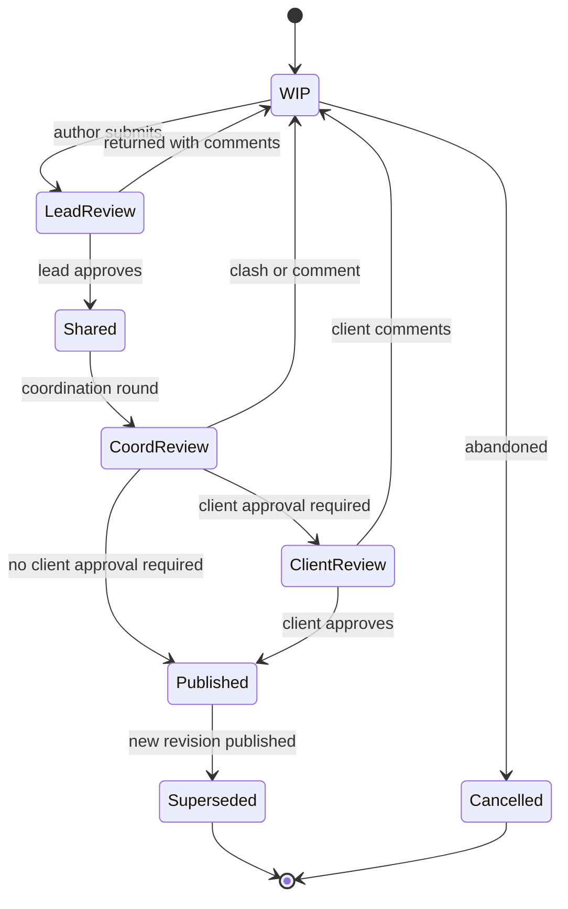

A thread is opened automatically at **LeadReview** and anchored to the Project Document. Publishing locks the thread (branch DH10).

### 3.2 Review round

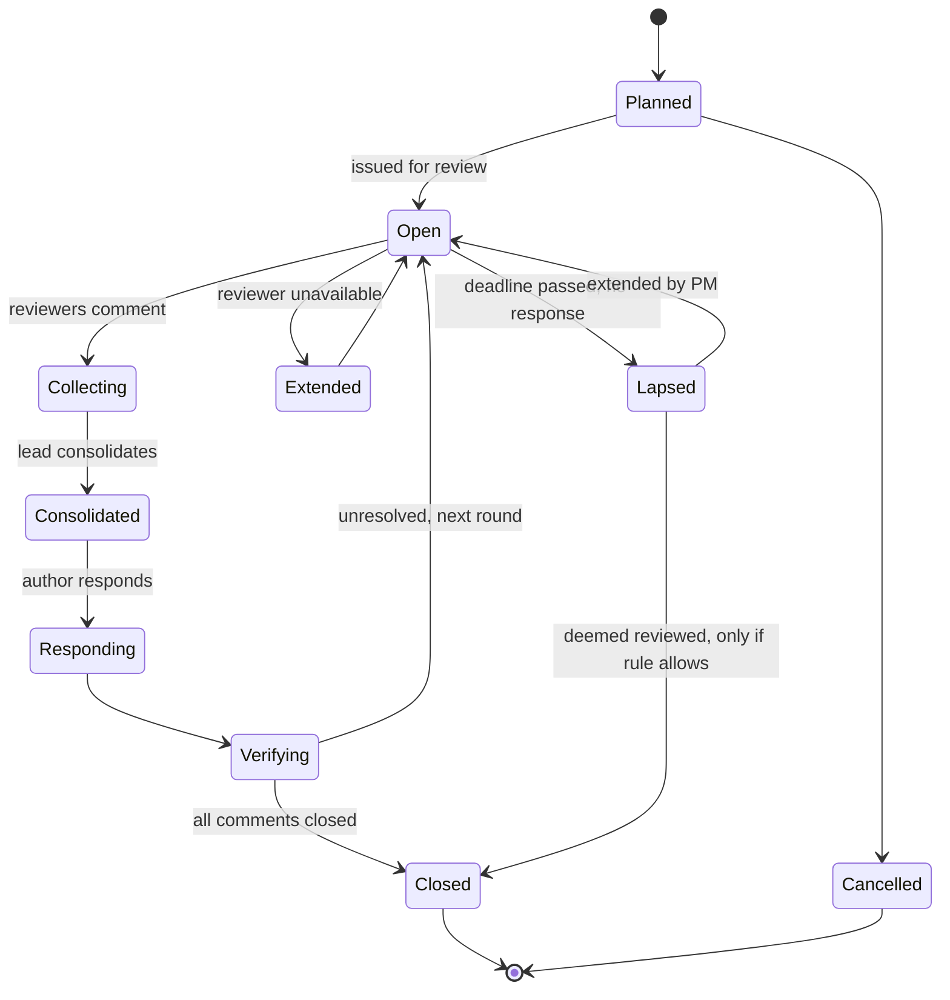

### 3.3 Review comment

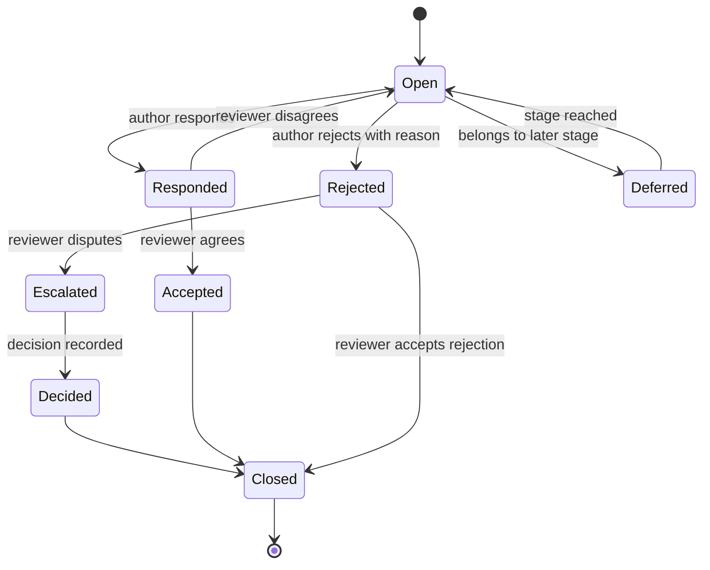

### 3.4 Discussion thread

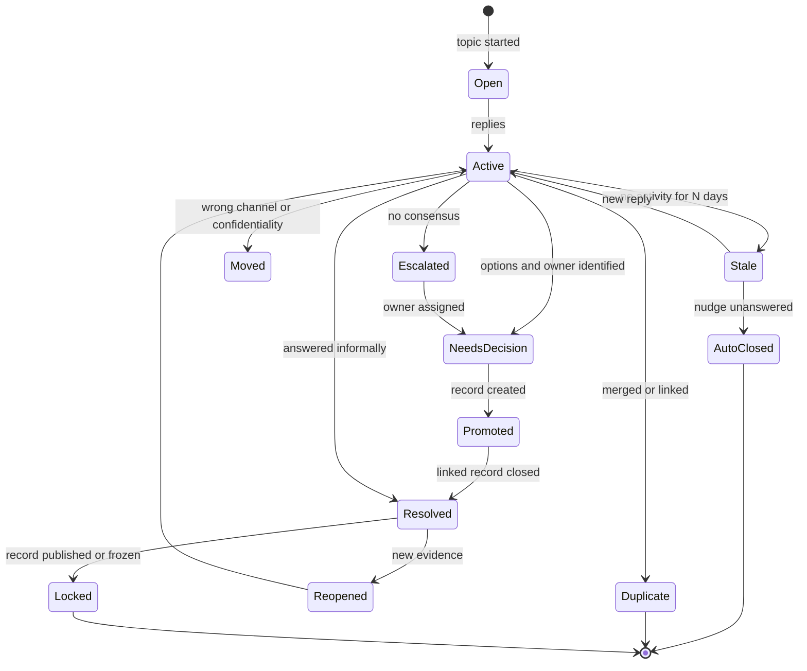

### 3.5 Design Change Request (DCR)

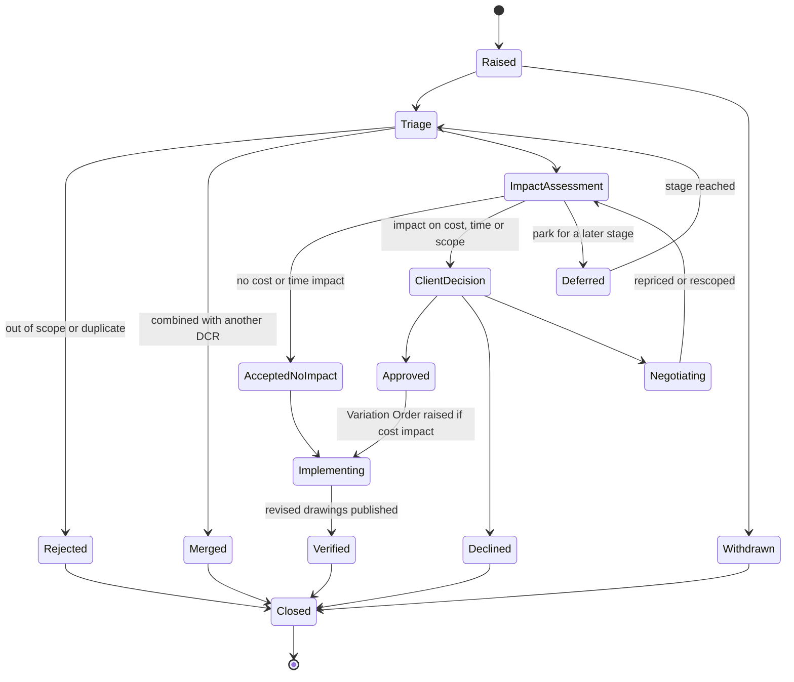

After design freeze, an extra **freeze board** approval is inserted before Implementing (branch DX8). Approved DCRs with cost impact create a Variation Order linked by reference; DCR decisions are mirrored to `P-decisions`.

### 3.6 Clash (BCF Topic) resolution

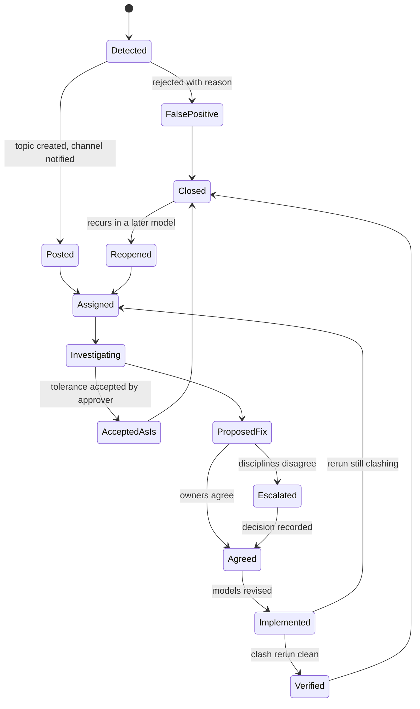

### 3.7 Client approval

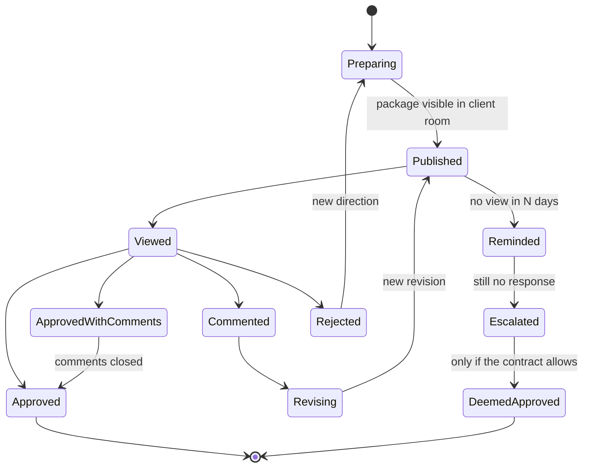

An approval records the approver's identity, time and the **revision hash of the package**. An approval of an earlier revision is not valid for a later one (branch DA6).

### 3.8 Design meeting

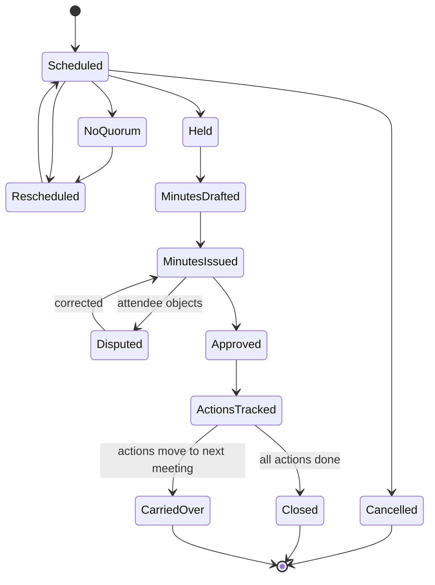

### 3.9 Design package issue

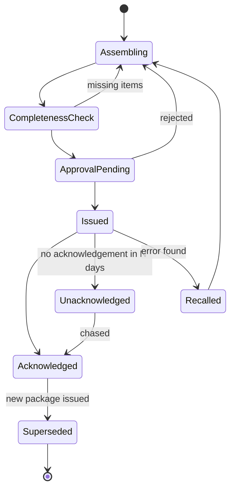

### 3.10 Consultant deliverable

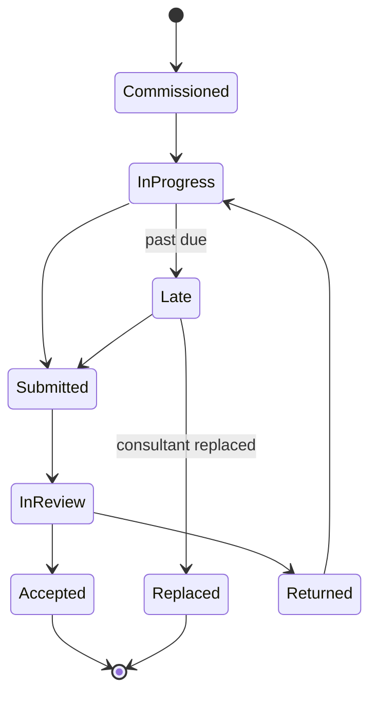

### 3.11 Design Decision

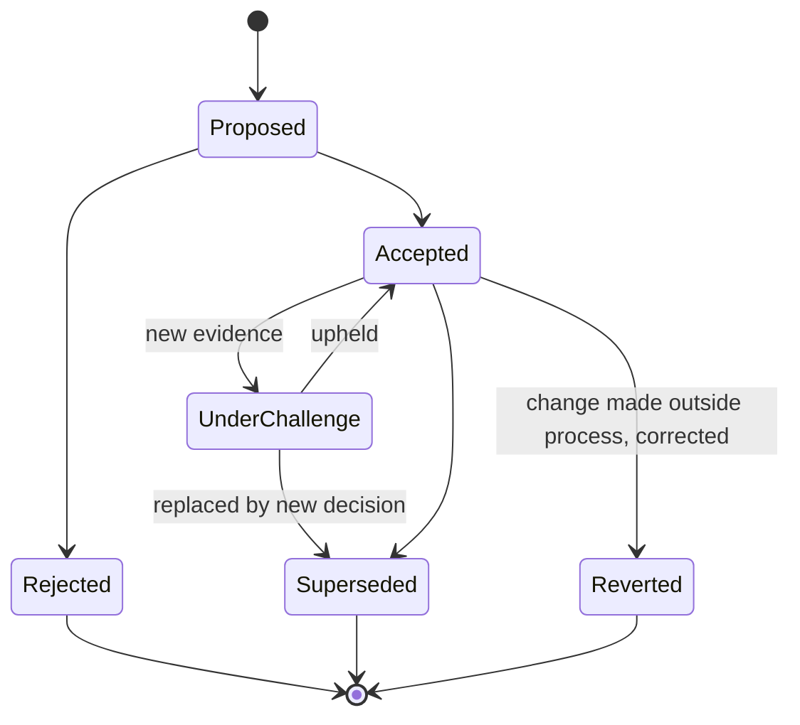

A Design Decision stores a **snapshot** of the thread messages that justified it, so later edits or deletion in chat cannot rewrite the record (branch DH9).

---

## 4. Roles and responsibilities (RACI)

R = responsible, A = accountable, C = consulted, I = informed.

| Activity | PM | Design Lead | Discipline engineer | BIM Coordinator | QS | Client Rep | Consultant |
|----------|----|-------------|---------------------|-----------------|----|-----------|-----------|
| Kickoff and responsibility matrix | A | R | C | C | C | C | I |
| Concept and options | I | A/R | C | I | C | C | C |
| Drawing authoring and lead review | I | A | R | C | I | I | R (own scope) |
| Coordination and clash resolution | I | A | R | R | I | I | R |
| DCR triage | C | A/R | C | C | C | I | I |
| DCR client decision | R | C | I | I | C | A | I |
| Cost and VE | C | R | C | I | A/R | C | C |
| Design stage gate approval | A | R | C | C | C | C | I |
| Client approval | R | R | I | I | I | A | I |
| Package assembly and issue | A | R | R | C | C | I | I |
| Decision recording | A | R | C | C | C | I | C |
| Chat moderation and channel hygiene | A | R | I | R | I | I | I |

---

## 5. Data model additions

| Doctype | Fields and notes |
|---------|------------------|
| `Design Stage` (child of the project design phase) | `stage` (D0 to D5), `status`, `gate_status`, `planned_start`, `planned_end`, `approved_on`, `approved_by` |
| `Design Review` | project, stage, review type (internal / coordination / client / authority / independent), scope (documents), participants, deadline, status (section 3.2), round number |
| `Review Comment` (child of Design Review) | document, location or viewpoint, comment, raised_by, status (section 3.3), response, deferred_to_stage, linked thread |
| `Design Change Request` | origin (client / internal / authority / site), description, affected documents, impact (cost, days, scope), status (section 3.5), linked VO, freeze flag |
| `Design Decision` | title, options considered, decision, decided_by, date, impact, source thread snapshot, status (section 3.11), linked documents |
| `Design Meeting` / `Meeting Action` | schedule, attendees, minutes document, actions with owner and due date, status (section 3.8) |
| `Design Package` | package number, scope, revision, contents (child table to Project Documents), status (section 3.9), transmittal link. Reuse an existing `Transmittal` doctype if one exists |
| `Consultant Deliverable` | consultant, scope, due date, status (section 3.10), linked documents |
| `Discuss Anchor` | section 2.2 |
| `Project Document` (existing core doctype) | Add `author`, `lead_reviewer`, `design_stage`, `client_approval_required`, `approved_revision_hash` |

---

## 6. Branch register

Format: **ID — trigger — outcome (returns to or ends at) — model**.

### DK. Kickoff (D0)

| ID | Trigger | Outcome | Model |
|----|---------|---------|-------|
| DK1 | Brief incomplete or contradictory | Kickoff held; clarification thread; client brief sign-off required before D1 (loop) | Project Document, thread |
| DK2 | Design team not fully assigned | Provisional assignment; gap flagged; DG1 blocked if a discipline lead is missing | Project User |
| DK3 | Consultant not yet appointed | Placeholder deliverable; channel created at appointment | Consultant Deliverable |
| DK4 | Naming and CDE convention not agreed | Default convention applied; validator warns but does not block | Project Document validator |
| DK5 | Channels fail to scaffold | Degraded flag and retry; design proceeds with comment-thread fallback | Event retry |
| DK6 | Client supplies prior design | Imported as baseline in Shared state with source tag; adopted or rejected after review | Project Document |
| DK7 | Scope change at kickoff | Brief revision; check for contract amendment | Contract, DCR |

### DC. Concept (D1)

| ID | Trigger | Outcome | Model |
|----|---------|---------|-------|
| DC1 | Multiple options developed | Options thread, canvas boards, optional poll; selection recorded as Design Decision | Design Decision |
| DC2 | Client prefers a hybrid | New option; loop within D1 | Design Decision |
| DC3 | Client approves as presented | DG1 passes | Design Stage |
| DC4 | Concept breaches budget or site constraint | Feasibility flag; escalate; VE or redirect | DCR, Decision |
| DC5 | Concept rejected entirely | Brief reset, back to D0 | Design Stage |
| DC6 | Site survey data missing or late | Assumption logged with risk and revisit trigger | Design Decision |
| DC7 | Inspiration or precedent sharing | Thread only; not promoted | Thread |

### DS. Schematic (D2)

| ID | Trigger | Outcome | Model |
|----|---------|---------|-------|
| DS1 | Area schedule mismatches brief | Review comment; revise | Review Comment |
| DS2 | Cost plan exceeds budget | VE, scope reduction or budget increase, recorded as a decision | Design Decision, DCR |
| DS3 | Authority pre-application feedback | Comments become DCRs and permit tasks | DCR, Permit |
| DS4 | Structural or MEP concept conflicts with architecture | Coordination thread; decision | Design Decision |
| DS5 | Client changes an approved item | DCR | DCR |

### DD. Development and coordination (D3)

| ID | Trigger | Outcome | Model |
|----|---------|---------|-------|
| DD1 | Clash run produces clashes | BCF topics posted to `-coordination` | BCF Topic |
| DD2 | Model federation fails (version mismatch) | Roll back to last good federation; model owners notified | Project Document |
| DD3 | Material needs a sample | Design-stage Submittal | Submittal |
| DD4 | Selected material unavailable or long-lead | Substitution thread; DCR if the design changes | DCR |
| DD5 | Supplier or contractor input needed | Design query routed as RFI | RFI |
| DD6 | Discipline deliverable late | Escalation ladder; resourcing decision | Task, ladder |
| DD7 | Coordination meeting decisions | Minutes; Design Decisions within 24 hours | Design Meeting |
| DD8 | Code or standard changes mid-design | Impact review; DCR flagged authority-driven | DCR |

### DT. Technical documentation (D4)

| ID | Trigger | Outcome | Model |
|----|---------|---------|-------|
| DT1 | Drawing set incomplete against register | Completeness check fails; missing list posted | Design Package |
| DT2 | Specs inconsistent with drawings | Review comment; revise | Review Comment |
| DT3 | BOQ quantities mismatch drawings | QS query; BOQ revision; takeoffs flagged stale | BOQ, Takeoff |
| DT4 | Late revision while package assembling | Package recalled and rebuilt | Design Package |
| DT5 | Permit needs a different format or signatures | Separate permit package | Design Package |
| DT6 | Independent or third-party check required | External review round | Design Review |
| DT7 | Professional sign-off missing | Issue blocked; reminder | Project Document |

### DR. Reviews and comments

| ID | Trigger | Outcome | Model |
|----|---------|---------|-------|
| DR1 | Reviewer silent past deadline | Ladder; then lapse or extension; deemed reviewed only if the rule allows | Design Review |
| DR2 | Two reviewers give conflicting comments | Conflict flagged; decision thread; Design Decision | Review Comment, Decision |
| DR3 | Author rejects a comment | Reason recorded; reviewer accepts or escalates | Review Comment |
| DR4 | Comment belongs to a later stage | Deferred with target stage; resurfaces then | Review Comment |
| DR5 | New comment after round closed | Logged as late; DCR if material, else next round | Review Comment, DCR |
| DR6 | Rounds exceed the limit | PM escalation or design workshop | Design Review |
| DR7 | Duplicate comment | Merged | Review Comment |
| DR8 | Markups in PDF, model or canvas | Unified as Review Comments with viewpoint attachments | Review Comment |
| DR9 | Reviewer leaves or is replaced | Open comments reassigned | Design Review |

### DX. Design change and value engineering

| ID | Trigger | Outcome | Model |
|----|---------|---------|-------|
| DX1 | Client-initiated change | DCR | DCR |
| DX2 | Internal improvement | DCR, internal origin | DCR |
| DX3 | Authority-mandated change | DCR flagged mandatory; client cannot decline | DCR |
| DX4 | Constructability issue from site | DCR from site | DCR |
| DX5 | No-impact change | Accepted; revision issued | DCR |
| DX6 | Cost or time impact | Client decision; VO linked | DCR, Variation Order |
| DX7 | Value engineering proposal | Options, savings, risk; approved or rejected; becomes DCR | DCR, Decision |
| DX8 | Change after freeze | Freeze board approval, stricter evidence | DCR |
| DX9 | Conflicting DCRs | Merged or sequenced | DCR |
| DX10 | Declined DCR raised again | Reopened only with new evidence | Design Decision |
| DX11 | Requester withdraws | Withdrawn, history kept | DCR |

### DB. Clashes

| ID | Trigger | Outcome | Model |
|----|---------|---------|-------|
| DB1 | False positive | Rejected with reason; clash rule tuned | BCF Topic |
| DB2 | Each discipline says the other must move | Escalated to coordinator and Design Lead; decision recorded | BCF Topic, Decision |
| DB3 | Tolerance acceptable | Accepted as is with approver | BCF Topic |
| DB4 | Fix creates a new clash | New topic linked to the first | BCF Topic |
| DB5 | Clash recurs after closure | Reopened | BCF Topic |
| DB6 | Critical clash open at gate | DG3 blocked | Design Stage |
| DB7 | Model owner unavailable | Reassigned | BCF Topic |
| DB8 | Clash resolved by site workaround | Recorded as a site decision and flowed back to as-built | Design Decision |

### DI. RFIs and submittals in design

| ID | Trigger | Outcome | Model |
|----|---------|---------|-------|
| DI1 | Information needed from client | RFI with client as ball-in-court; ladder if overdue | RFI |
| DI2 | Answer implies a design change | DCR | RFI, DCR |
| DI3 | Question answered in chat only | Promotion prompt; unrecorded answer is not binding; nag | Thread, RFI |
| DI4 | Duplicate RFI | Merged | RFI |
| DI5 | Sample rejected | Resubmit or alternative | Submittal |
| DI6 | Approved with notes | Notes carried into the spec | Submittal |

### DM. Meetings

| ID | Trigger | Outcome | Model |
|----|---------|---------|-------|
| DM1 | Meeting scheduled | Agenda thread; Meet link | Design Meeting |
| DM2 | No quorum | Rescheduled | Design Meeting |
| DM3 | Minutes disputed | Corrected and reissued | Design Meeting |
| DM4 | Decisions taken | Decision records within 24 hours, else flagged | Design Decision |
| DM5 | Action overdue | Ladder | Meeting Action |
| DM6 | Meeting cancelled | Open actions carried over | Meeting Action |
| DM7 | Ad-hoc call produces a decision | Decision-capture prompt to the call owner | Design Decision |

### DA. Client approval

| ID | Trigger | Outcome | Model |
|----|---------|---------|-------|
| DA1 | Client approves | Recorded with identity, time and revision hash | Project Document |
| DA2 | Approves with comments | Conditional; comments tracked; proceeding at risk is a configured option | Review Comment |
| DA3 | Client rejects | Revise, or brief reset | Design Stage |
| DA4 | Client silent | Reminders; escalation; deemed approval only if the contract allows | Contract, ladder |
| DA5 | Multiple client reps disagree | Client must nominate the approver; conflict thread | Project User |
| DA6 | Approval refers to an older revision | Not valid for the new revision; flagged | Project Document |
| DA7 | Client asks to change an approved item | DCR | DCR |
| DA8 | Client answers by email or phone | PM logs it into the thread; unlogged is not binding | Thread |
| DA9 | Client portal unavailable | Share link or PDF fallback, logged | Files |

### DE. External consultants

| ID | Trigger | Outcome | Model |
|----|---------|---------|-------|
| DE1 | Consultant onboarded | Private channel; access to own folder only | Project User |
| DE2 | Deliverable late | Ladder; replacement option | Consultant Deliverable |
| DE3 | Deliverable returned | Resubmission loop | Consultant Deliverable |
| DE4 | Consultant design conflicts with in-house | Coordination thread and decision | BCF Topic, Decision |
| DE5 | Consultant leaves | Offboarding: revoke, archive channel, reassign | Project User |
| DE6 | Consultant not on the platform | PM acts as proxy; entries tagged proxy | Thread |
| DE7 | Commercially sensitive information | Private channels only; no cross-posting | Channel policy |

### DF. Freeze and issue

| ID | Trigger | Outcome | Model |
|----|---------|---------|-------|
| DF1 | Package assembled and approved | Issued; freeze recorded; acknowledgement tracked | Design Package |
| DF2 | Recipient does not acknowledge | Chase; escalate | Design Package |
| DF3 | Error found after issue | Recall; reissue with supersede notice | Design Package |
| DF4 | Early package for long-lead items | Partial issue before full freeze | Design Package |
| DF5 | Freeze with open items | Gate A waiver with standing task | Phase Gate Item |
| DF6 | Change after freeze | DX8 | DCR |
| DF7 | Gate A design checks fail | Remediation list; back to D4 | Project Phase |

### DH. Discussion threads

| ID | Trigger | Outcome | Model |
|----|---------|---------|-------|
| DH1 | New topic | Thread opened in the correct channel | Thread |
| DH2 | Topic relates to a record | Anchor created | Discuss Anchor |
| DH3 | Answered informally | Resolved | Thread |
| DH4 | Needs a decision or formal answer | Promoted to a record | Promotion |
| DH5 | No activity for N days | Nudge; then auto-closed with notice | Scheduler |
| DH6 | Duplicate topic | Linked or merged | Thread |
| DH7 | Posted in the wrong channel | Moved; original redirected | Thread |
| DH8 | Confidential content in a wider channel | Moved or removed; audit entry | Audit |
| DH9 | Message edited or deleted after a decision cited it | Decision keeps its snapshot; edit flagged | Design Decision |
| DH10 | Record published or frozen | Thread locked | Discuss Anchor |
| DH11 | New evidence after resolution | Reopened | Thread |
| DH12 | No consensus | Escalated to the decision owner | Thread |
| DH13 | Heated or unprofessional exchange | Moderation; temporary mute; PM informed | Channel policy |
| DH14 | Drawing or model posted as a file in chat | Redirected to Files; chat shows a link | Policy |

### DN. Notifications

| ID | Trigger | Outcome | Model |
|----|---------|---------|-------|
| DN1 | Many documents change at once | Batched into a digest | Handler |
| DN2 | Mentioned user is on leave | Delegate notified | Project User |
| DN3 | Notification missed | Ladder reminder | Ladder |
| DN4 | User muted the channel | Critical alerts still sent by direct message | Notification rules |
| DN5 | Retry would duplicate an alert | Idempotency key suppresses it | Event registry |
| DN6 | Outside working hours or time zone | Deferred to start of day, except critical | Notification rules |

### DP. Access

| ID | Trigger | Outcome | Model |
|----|---------|---------|-------|
| DP1 | New team member | Added to channels by role | Project User |
| DP2 | Role change | Channel membership recomputed | Project User |
| DP3 | Member leaves | Removed; history retained | Project User |
| DP4 | Client added | Client room only | Project User |
| DP5 | Attempt to open a private channel | Denied; audit entry | Permissions |
| DP6 | Internal content reaches the client room | Incident: remove, audit, notify; covered by leak tests | Incident |
| DP7 | Raven does not support guests | Alternative client and consultant surface (spike R2) | ChatProvider |

### DZ. System failures

| ID | Trigger | Outcome | Model |
|----|---------|---------|-------|
| DZ1 | Raven unavailable | Posts queued; record workflows continue; comment-thread fallback | ChatProvider |
| DZ2 | Alert delivery fails | Retry; dead-letter list; admin alert | Event registry |
| DZ3 | Storage unavailable | Previews fail; links shown; documents read-only | StorageProvider |
| DZ4 | Anchor points to a missing record | Anchor marked Orphaned; repair job | Discuss Anchor |
| DZ5 | Channel deleted by mistake | Recreate from anchors; policy is archive, never delete | ChatProvider |
| DZ6 | Chat and record disagree | The record wins; thread annotated | Policy |

---

## 7. Events added to the registry

| Event | Emitted when | Consumers |
|-------|--------------|-----------|
| `design.stage_changed` / `design.gate_passed` / `design.gate_failed` | D0 to D5 and DG1 to DG4 changes | Chat, counts, Gate A |
| `document.shared` / `document.published` | ISO state changes | Chat, takeoff staleness |
| `review.opened` / `review.lapsed` / `review.closed` | Review round changes | Chat, ladder |
| `comment.escalated` | Review comment disputed | Chat, decision |
| `dcr.raised` / `dcr.decided` / `dcr.implemented` | DCR transitions | Chat, VO, decisions feed |
| `decision.accepted` / `decision.superseded` | Decision changes | `P-decisions` |
| `clash.posted` / `clash.escalated` / `clash.closed` | BCF transitions | `P-coordination`, gate check |
| `client_approval.requested` / `client_approval.recorded` | Approval changes | Client room, gates |
| `package.issued` / `package.recalled` / `package.acknowledged` | Package changes | Chat, transmittal |
| `deliverable.late` / `deliverable.accepted` | Consultant changes | Consultant channel |
| `meeting.minutes_issued` / `action.overdue` | Meeting changes | Chat, ladder |
| `thread.promoted` / `thread.stale` / `thread.locked` | Thread changes | Anchors, nudges |
| `access.channel_changed` | Membership recomputed | Reconcile |

---

## 8. Gate A design-side checks (refined)

| Check | Rule |
|-------|------|
| DG4 approved | Recorded with revision hash |
| Drawing set | Every register item Published; none in WIP or Shared |
| Client approval | Present for the exact issued revision |
| Clashes | Zero open critical; others closed, accepted or deferred with approval |
| Review comments | All Closed, Accepted, or Deferred with approval |
| RFIs | None open and blocking |
| Decisions | No critical Design Decision in Proposed state |
| DCRs | None open for the issued scope |
| Consultants | All deliverables Accepted |
| Package | Issued and acknowledged |
| BOQ | Revision frozen as the baseline candidate |

---

## 9. Metrics

Comment turnaround time, review rounds per drawing, open clashes by discipline and age, RFI response time, decision latency (thread start to Design Decision), ratio of threads promoted to threads resolved informally, stale-thread count, DCR count and cost impact by origin, late deliverables by consultant, unacknowledged packages.

---

## 10. Testing

- **State machines:** generate tests from the transition tables in section 3: allowed path, denied role, and terminal-state checks for each sub-cycle.
- **Client room leakage:** the highest-priority test. A client user must never read internal channels, internal threads or unpublished packages (branches DP5, DP6).
- **Membership sync:** role change and removal update channels and shares immediately (A4).
- **Promotion:** each promotion type creates the record, the anchor and the system message exactly once, even if the handler retries.
- **Escalation timers:** simulate time to verify each ladder step fires once, in order, and stops when the item closes.
- **Decision snapshots:** editing or deleting a cited message does not change a Design Decision.
- **Gates:** one test per check, plus waiver and "turns red after pass" cases.
- **Failure paths:** Raven down, storage down and duplicate alerts run against fake providers in CI and against real services on staging.

---

## 11. Policies to configure before go-live

Deemed approval (allowed by contract or not); review round limit; thread stale threshold; escalation ladder per item type; whether "approved with comments" lets the next stage start at risk; who may waive gates; which items are visible to the client; retention for chat and decision snapshots; whether direct messages are exempt from retention or audit.

---

## 12. Spikes for Discuss

| ID | Question | Exit criterion |
|----|----------|----------------|
| R1 | Can channels, threads and posts be created through a stable Raven API? | `ensure_channel`, `post` and thread creation work from Python against a pinned version |
| R2 | Can a Website User (client or consultant) be a channel member? | Yes with isolation test, or the portal-thread fallback is chosen |
| R3 | Can Raven add a custom message action ("Promote")? | Yes, or the shell provides the action |
| R4 | Can one Document Alert route to a per-project channel? | Yes, or `ws_raven` handlers do the posting |
| R5 | Are there mention groups (roles) in Raven? | Yes, or mentions stay per-user with ladder escalation |
| R6 | What happens on edit and delete (history, audit)? | Policy confirmed; decision snapshot approach validated |
| R7 | How does Raven behave under alert load (digest, rate)? | Batch strategy chosen |
| R8 | Archive versus delete, and data export | Retention policy implementable |
| R9 | Does workflow-action-from-chat respect our permission hooks? | Verified with a denied-role test |
| R10 | Licence of Raven | Read the repository LICENSE file and record it |

---

## 13. Open decisions

| # | Decision | Effect |
|---|----------|--------|
| O1 | Is deemed approval allowed under the contract | DA4, DR1 |
| O2 | Number of design stages: keep D1 to D5 or merge concept and schematic | Gate count |
| O3 | Does the client approve every stage or only DG1, DG2 and DG4 | Client-room traffic |
| O4 | Are consultants on the platform or email-only | DE1, DE6, spike R2 |
| O5 | Direct messages allowed or discouraged | DH14, retention |
| O6 | One Raven workspace per company with prefixed channels, or per project | Channel count and admin load |
| O7 | Extend existing doctypes (RFI, Transmittal) or create new ones | Section 5 |
