# Construction Project Lifecycle — Full Cycle and Branch Register

Companion to *Construction Collaboration Workspace — Architecture v3 (Frappe Suite First)*.

## 0. Scope and conventions

- "Plan" is read as **the whole life of a construction project** from first lead to archive, as run inside the workspace. Drawing, document and permit lifecycles are covered as sub-cycles.
- **Stage** = where the project is (S0–S10). **Condition** = a modifier that can apply in most stages (Normal, On Hold, Suspended, In Dispute, Terminated). Keep them as two fields so a project can be "Construction + On Hold".
- ERPNext's native `Project.status` stays native and is **derived**: Open from S3 to S9, Completed at S10, Cancelled for early terminal outcomes after a project exists. Add Custom Fields `lifecycle_stage` and `lifecycle_condition` on `Project`; do not overload `status`.
- **Pre-contract stages (S0–S2) live on CRM objects** (Lead, Opportunity, Quotation, or a Frappe CRM Deal, plus the ERPNext `Contract`). The project-scoped workspace starts at S3. Open decision O1 covers large bids that need a workspace earlier.
- Two additions beyond v3's three phases, because retention cannot be released without them: **S8 Defects Liability Period (DLP)** and **S9 Final Account**.
- Every transition is a Frappe Workflow transition with a role requirement and server-side validation, and emits an event through the event registry (section 7).
- IDs: **C** commercial, **K** contract, **M** mobilization, **D** design and permits, **G** gates, **P** procurement and subcontract, **X** construction, **Z** closing, **L** defects liability, **F** final account, **E** exceptions, **S** system and integration, **A** access.

---

## 1. Master lifecycle

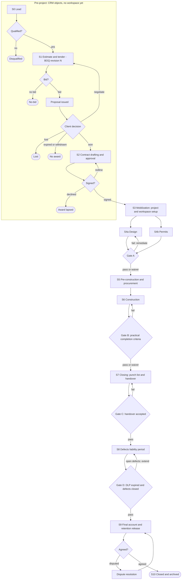

Notes on the master diagram:

- S4a Design and S4b Permits run **in parallel**; Gate A needs both.
- S5 can start before Gate A for **long-lead items** if a waiver or an early-procurement approval exists (branch P9).
- S6 contains the repeating inner cycles in section 3 (daily report, billing, RFI, submittal, inspection, variation).
- From S3 to S9, any project can enter a **condition** branch (section 2): hold, suspension, dispute, termination.

---

## 2. Condition machine (applies from S3 to S9)

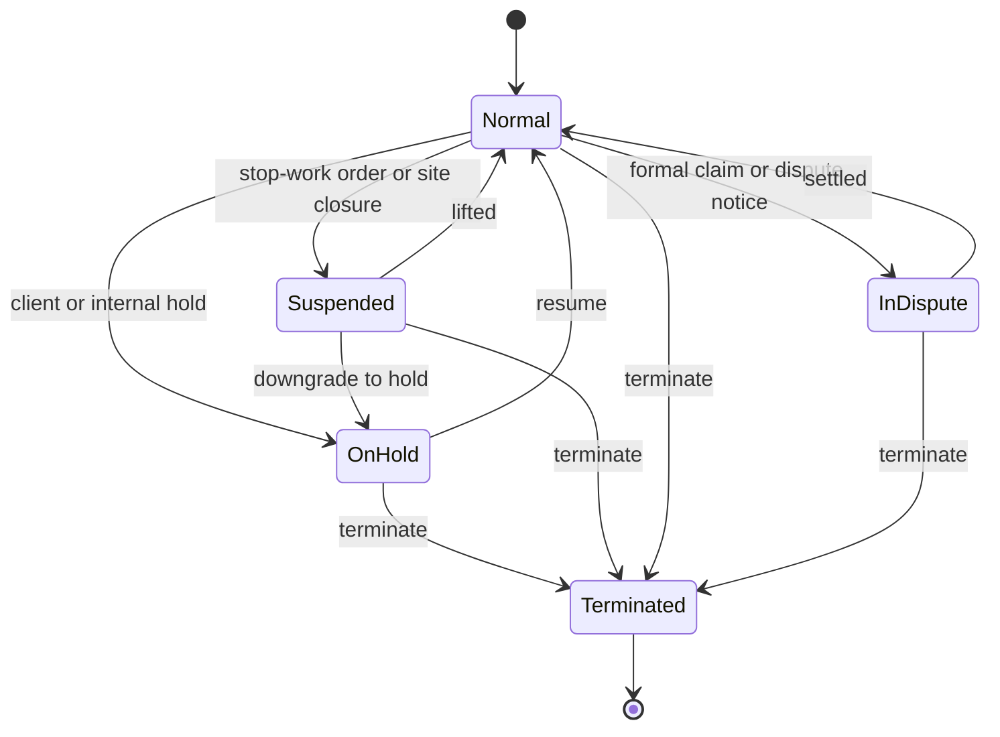

Rules: hold and suspension **pause the schedule clock** and block new Progress Billing and new POs (configurable); termination triggers close-out accounts (branch E2); dispute is a flag that can coexist with Hold but blocks S10.

---

## 3. Sub-cycles (state machines)

### 3.1 Contract (ERPNext `Contract` + `stage`)

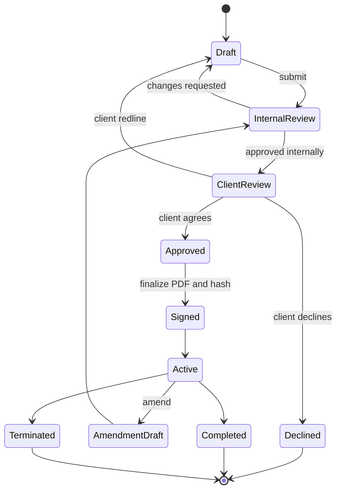

### 3.2 Document / drawing (ISO 19650 state on `Project Document`)

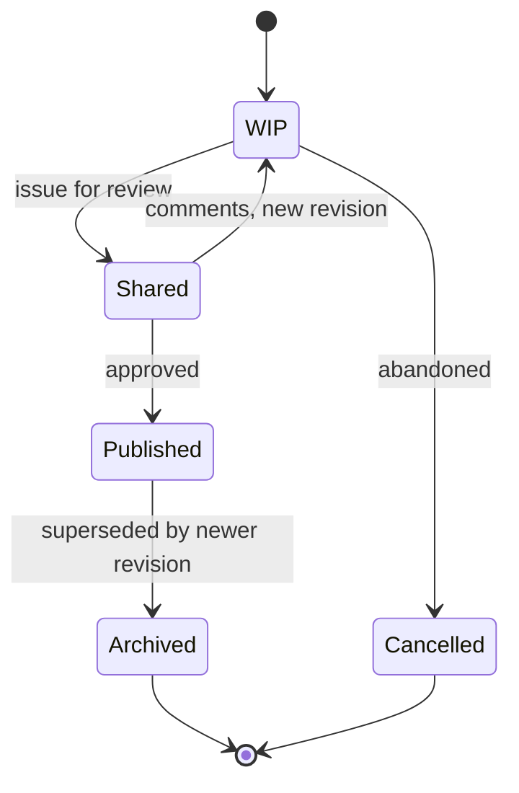

Publishing a revision flags dependent takeoffs and measurements `stale`.

### 3.3 RFI

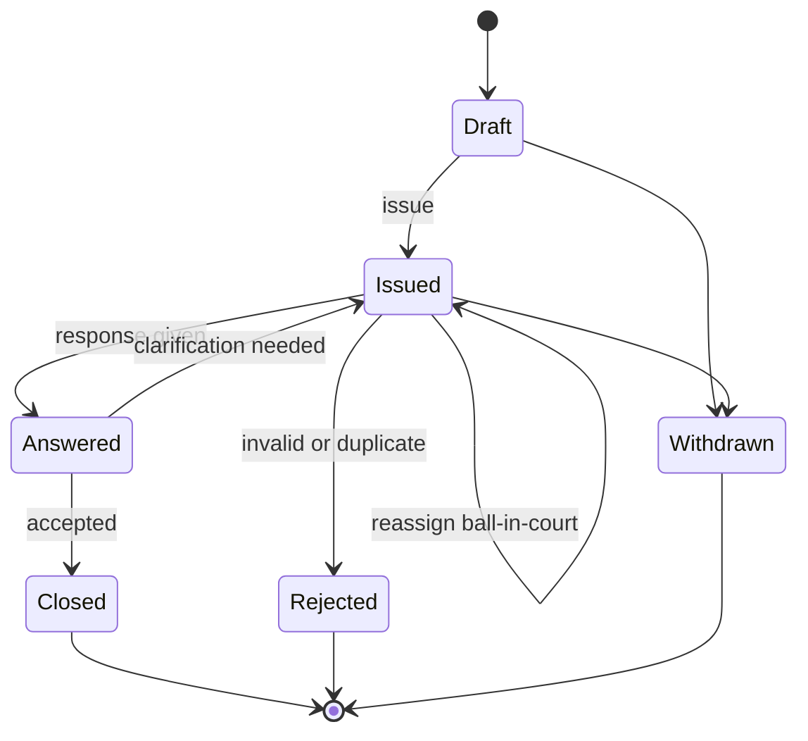

An answered RFI with **cost or schedule impact** also starts a Variation Order (branch X6).

### 3.4 Submittal

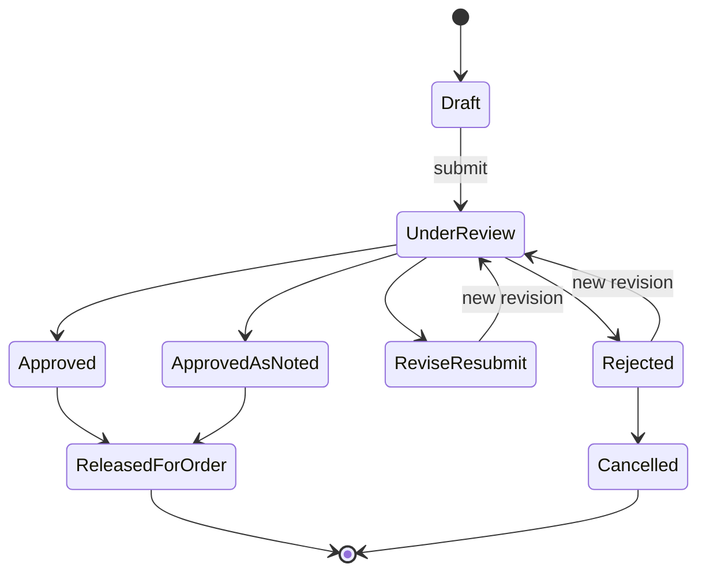

### 3.5 Permit

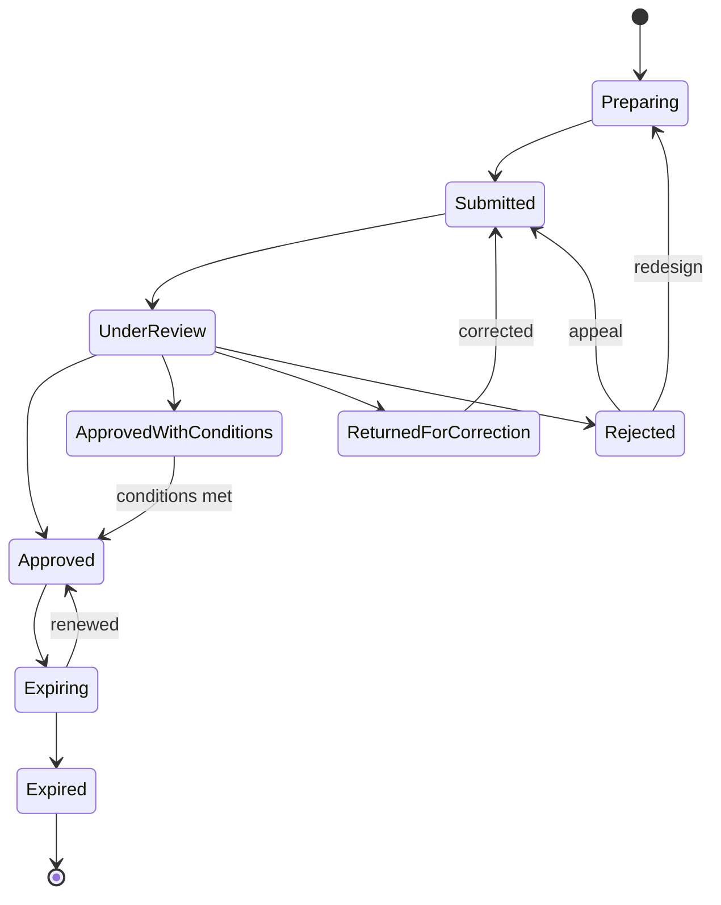

### 3.6 Procurement (material)

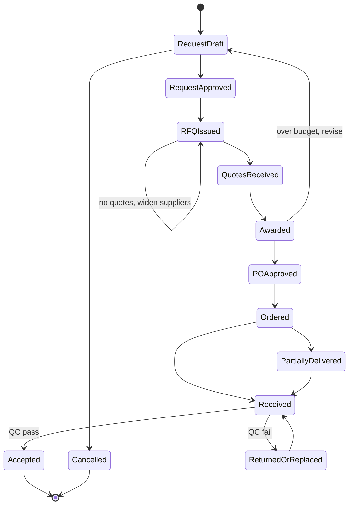

### 3.7 Variation Order

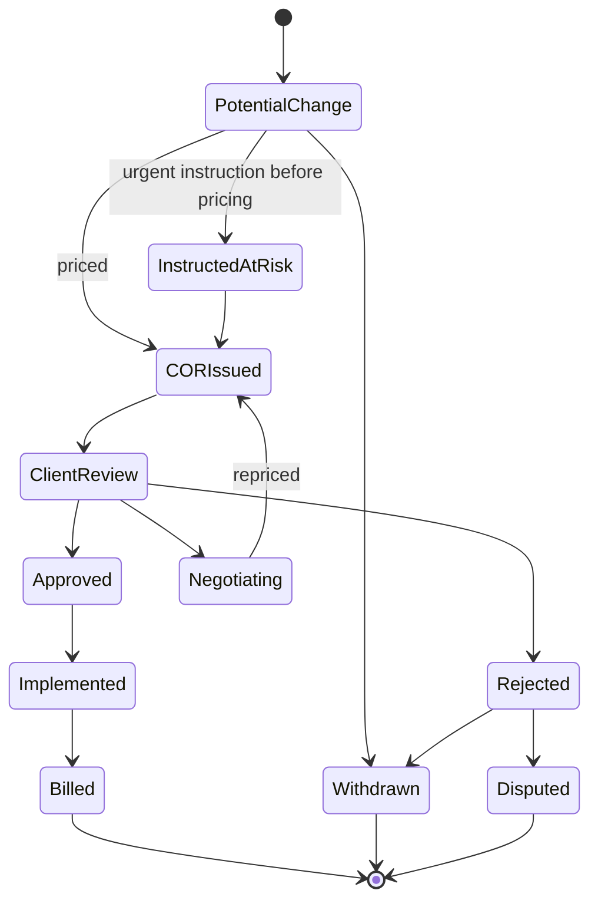

Approval adds delta lines to the BOQ (never edits the baseline), adjusts the contract sum and, if granted, the completion date.

### 3.8 Progress billing

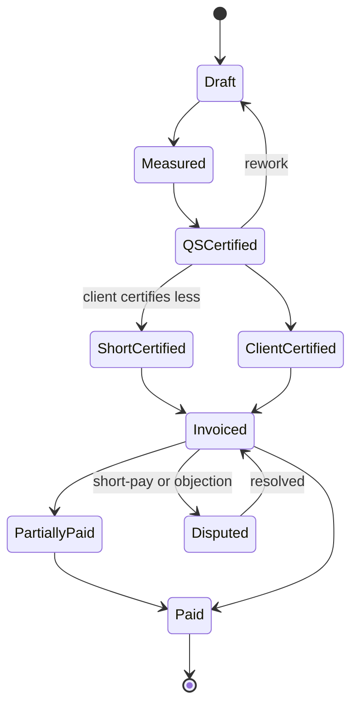

Retention accrues on every certified valuation; advance payment is recouped proportionally.

### 3.9 Inspection and NCR

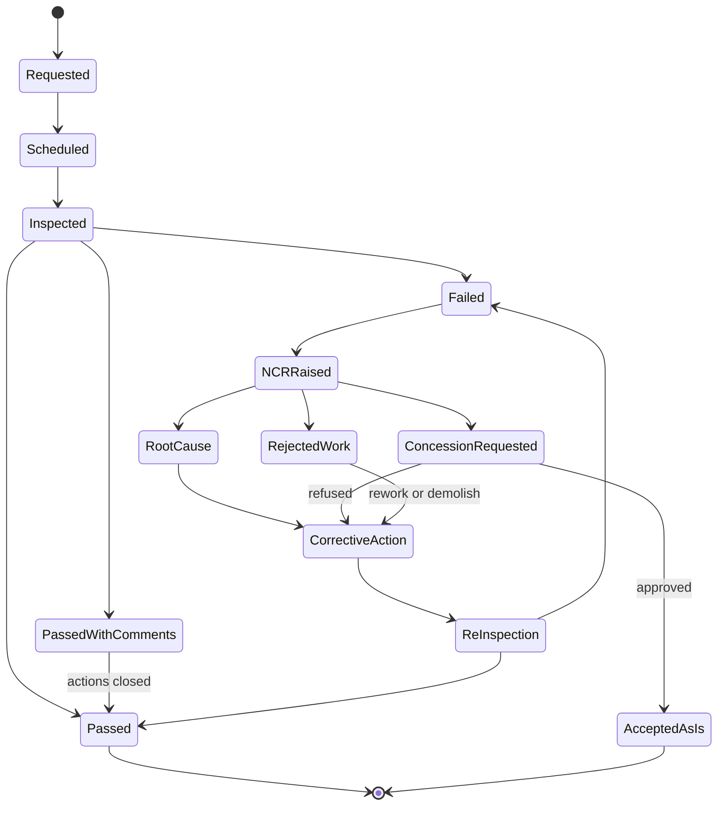

### 3.10 Punch list and defect (S7 and S8 share it)

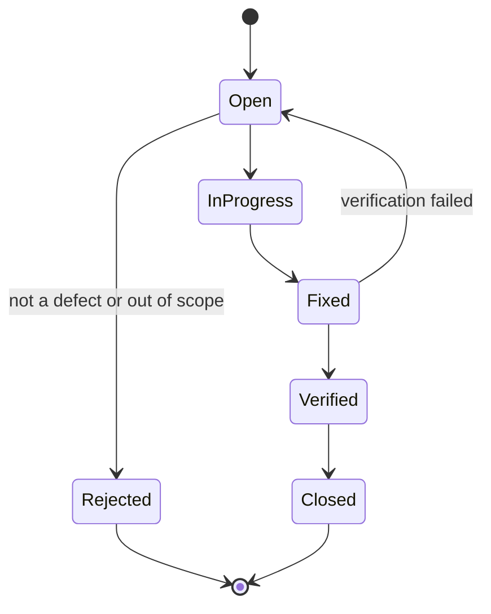

### 3.11 Phase gate

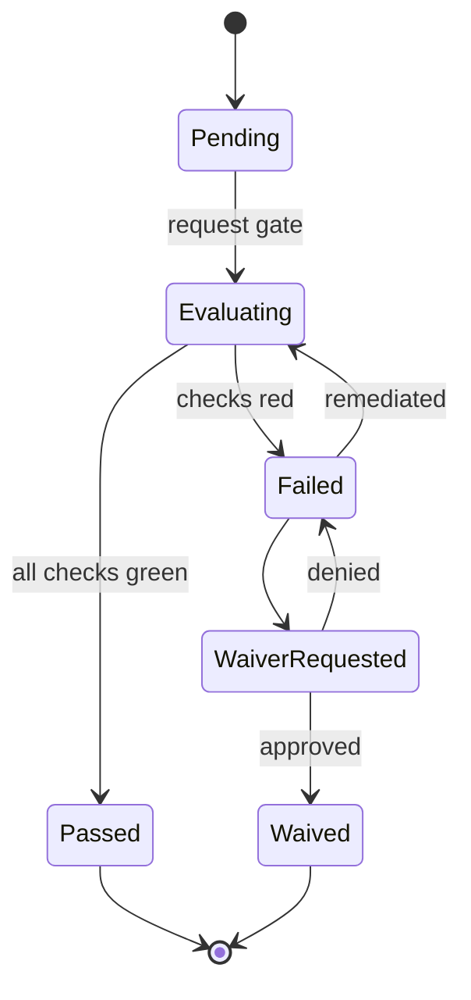

### 3.12 Member and client access

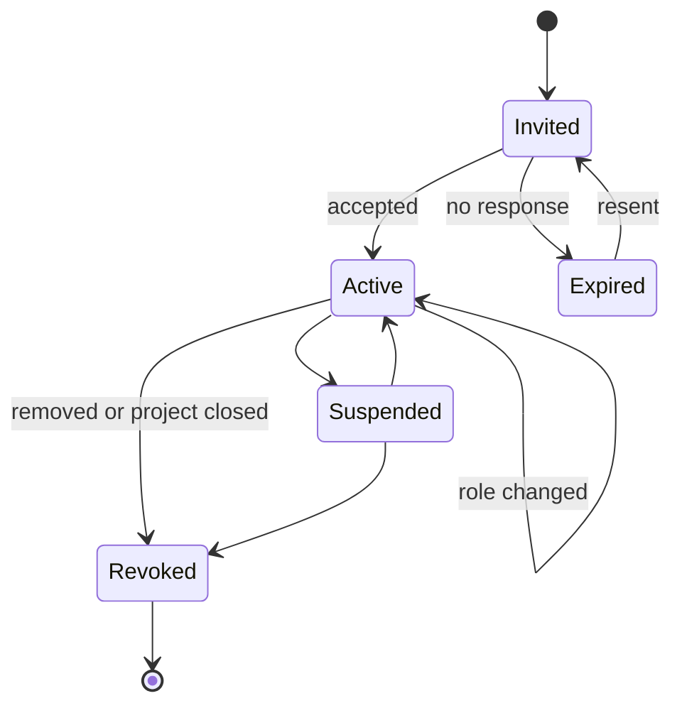

Every transition into **Revoked** or a role change runs the storage share reconcile (branch A4).

---

## 4. Stage reference

| Stage | Entry trigger | Main activities | Primary records | Exit gate | Owner roles |
|-------|--------------|-----------------|-----------------|-----------|-------------|
| **S0 Lead** | Enquiry | Capture, qualify | Lead, Opportunity | Qualified | Sales |
| **S1 Estimate and tender** | Qualified, bid decision | BOQ revision N, pricing, proposal | BOQ, Quotation | Client decision | Estimator, PM |
| **S2 Contract** | Won | Draft from template, review, redline, approve, sign | Contract, Project Document | Signed PDF and hash | PM, Accountant, Legal |
| **S3 Mobilization** | Contract signed | Create project, scaffold workspace, invite team and client, seed tasks | Project, Workspace Config, Project User | Workspace ready | PM |
| **S4a Design** | Mobilized | Drawings, reviews, RFIs, clashes, design changes | Project Document, RFI, BCF Topic | Gate A | Architect, Engineers |
| **S4b Permits** | Mobilized | Applications, corrections, conditions | Permit | Gate A | PM, Permit officer |
| **S5 Pre-construction and procurement** | Gate A | Long-lead orders, subcontract awards, schedule baseline, site setup | Material Request, PO, Subcontract Order, Project Baseline | Start of works | PM, Procurement, Site Engineer |
| **S6 Construction** | Start of works | Daily reports, progress, inspections, NCRs, variations, billing, safety | Site Daily Report, Inspection, NCR, Variation Order, Progress Billing | Gate B | Site Engineer, QS, PM |
| **S7 Closing** | Gate B | Punch list, re-inspection, practical completion, handover package | Punch List Item, Handover Package | Gate C | PM, Site Engineer, Client |
| **S8 DLP** | Gate C | Defect reports, repairs, warranty claims | Defect (Punch List Item), Warranty | Gate D | PM, Client |
| **S9 Final account** | Gate D | Final valuation, retention release, claims settlement | Progress Billing (final), Sales Invoice | Agreed final account | Accountant, QS, PM |
| **S10 Closed** | Final account agreed | Archive read-only, retention schedule, lessons learned | Project (Completed) | none | PM |

---

## 5. Gate definitions

All checks run **server-side** in `validate`; the UI only displays them.

| Gate | Checks (all must pass) | Waiver approver |
|------|------------------------|-----------------|
| **A** Design to pre-construction | Contract signed and Active; required drawing set Published (none in WIP or Shared); no open RFI flagged blocking; required permits Approved (conditions tracked as tasks); advance payment received if the contract requires it | PM plus Client representative |
| **B** Practical completion | All contract-works tasks complete; mandatory inspections Passed; no open critical NCR; no open stop-work; as-built drawings submitted for completed works | PM plus Client representative |
| **C** Handover accepted | Punch list has zero open critical items and every open item has an agreed date; handover package complete (as-builts, O&M manuals, warranties, certificates); client sign-off recorded; Certificate of Practical Completion issued | Client representative |
| **D** DLP end | DLP period elapsed (extended automatically if defects are open); all defects Closed or Rejected with reason; warranties registered | PM plus Client representative |
| **Final account** | Final valuation certified; all VOs Billed, Withdrawn or Disputed-and-settled; no open dispute; retention release amount computed | Accountant plus Client representative |

Waivers are first-class: reason, approver, expiry, and a standing task listing what was waived. A waived check is shown permanently on the project.

---

## 6. Branch register

Format: **ID — trigger → outcome (returns to / ends at) — model**.

### C. Commercial (S0–S1)

| ID | Trigger | Outcome | Model |
|----|---------|---------|-------|
| C1 | Lead not qualified | Disqualified, reason captured (terminal) | Lead status |
| C2 | Bid / no-bid decision is no | No-bid (terminal) | Opportunity status |
| C3 | Pricing needs more information | Back to S1, next BOQ revision | BOQ revision |
| C4 | Client negotiates | Revised proposal (loop to S1) | Quotation amendment |
| C5 | Client chooses a competitor | Lost, loss reason captured (terminal) | Opportunity status |
| C6 | Proposal expires or is withdrawn | No award (terminal) | Quotation valid-till |
| C7 | Client accepts | Proceed to S2 | Opportunity Won |
| C8 | Letter of intent or early works before signature | Conditional mobilization flagged `at_risk` with capped spend, then S2 continues in parallel | Project flag |

### K. Contract (S2)

| ID | Trigger | Outcome | Model |
|----|---------|---------|-------|
| K1 | Internal review requests changes | Draft, new Project Document revision | Contract stage |
| K2 | Client redlines | Draft, new revision (loop) | Contract stage |
| K3 | Client declines to sign | Declined, award lapsed (terminal) | Contract stage |
| K4 | Approved | Signed: PDF frozen, SHA-256 stored, file read-only | `finalize()` |
| K5 | Amendment (scope, sum, time, novation) | Amendment draft, new revision, signed PDF never overwritten | Contract stage |
| K6 | Termination | Terminated, see E2 | Contract stage |
| K7 | Works and DLP complete | Completed | Contract stage |
| K8 | `finalize()` fails | Stays Approved, retried, alert raised | Event retry |

### M. Mobilization (S3)

| ID | Trigger | Outcome | Model |
|----|---------|---------|-------|
| M1 | Scaffold succeeds | Proceed to S4 | Workspace Config |
| M2 | Storage or chat unavailable during scaffold | Project proceeds with `degraded` flag, retry queue, alert; idempotent re-scaffold | Event handlers |
| M3 | Client invitation accepted | Portal active | Project User |
| M4 | Invitation bounces or expires | Resend or alternate contact | Project User |
| M5 | Team member added or removed | Permission sync plus share reconcile | Project User, User Permission |
| M6 | Folder template changes after creation | Applied additively only, never deletes | Folder Template |

### D. Design and permits (S4)

| ID | Trigger | Outcome | Model |
|----|---------|---------|-------|
| D1 | Review comments on a drawing | New revision, WIP to Shared loop | Project Document |
| D2 | Drawing approved | Published; takeoffs on prior revision flagged stale | Project Document |
| D3 | Newer revision published | Prior revision Archived | Project Document |
| D4 | Client changes scope in design | Revision if no impact; Variation Order if cost or time impact | VO |
| D5 | Clash or model issue found | BCF Topic, Task, resolved, drawing revision | BCF Topic, Task |
| D6 | RFI answered | Closed, or clarification loop, or VO if impact | RFI |
| D7 | RFI invalid or duplicate | Rejected (terminal) | RFI |
| D8 | Permit returned for correction | Corrected and resubmitted (loop) | Permit |
| D9 | Permit approved with conditions | Conditions become tasks; Approved when all met | Permit, Task |
| D10 | Permit rejected | Appeal, or redesign (loops to S4a) | Permit |
| D11 | Permit nearing expiry | Renewal task; expiry blocks Gate A or works | Permit scheduler |
| D12 | Gate A fails | Missing checks listed; remediation tasks; re-evaluate | Project Phase |
| D13 | Gate A waiver | Approved waiver with standing task | Phase Gate Item |

### P. Procurement and subcontract (S5–S6)

| ID | Trigger | Outcome | Model |
|----|---------|---------|-------|
| P1 | Request over budget | Revise, or VO request, or reallocate | Material Request |
| P2 | RFQ draws no quotes | Widen supplier list, reissue (loop) | RFQ |
| P3 | PO rejected by approver | Back to request | PO workflow |
| P4 | Delivery partial or late | Partial receipt; delay entry; schedule impact check | Purchase Receipt |
| P5 | QC fails on receipt | Return or replace; credit note; loop to receipt | Purchase Receipt, Quality Inspection |
| P6 | Submittal not yet approved | PO held (lead-time gating) | Submittal link |
| P7 | Price changes after order | PO amendment, budget check | PO |
| P8 | Subcontract tender | Award, order, certificates, retention, final certificate | Subcontract Order |
| P9 | Long-lead item needed before Gate A | Early procurement approval or Gate A waiver | PO, Phase Gate Item |
| P10 | Subcontractor defaults or becomes insolvent | Termination, replacement, back-charges | Subcontract Order, back-charge |
| P11 | Material shortage threatens programme | Recovery plan or extension of time claim | Delay Entry |

### X. Construction (S6)

| ID | Trigger | Outcome | Model |
|----|---------|---------|-------|
| X1 | Daily report missing | Reminder then escalation | Site Daily Report scheduler |
| X2 | Task behind schedule | Delay entry with reason code; recovery plan or extension claim | Delay Entry |
| X3 | Inspection fails | NCR | Inspection |
| X4 | Inspection passes with comments | Comment actions tracked to closure | Inspection |
| X5 | NCR concession requested | Accepted as-is with approval, or refused to corrective action | NCR |
| X6 | Change instructed or identified | Potential Change; priced; approved, negotiated, rejected | Variation Order |
| X7 | Instruction given before pricing | Instructed at risk, priced afterwards | Variation Order |
| X8 | VO rejected | Withdrawn, or Disputed (to E3) | Variation Order |
| X9 | VO approved | BOQ delta, contract sum update, optional time extension, schedule re-baseline | VO, Project Baseline |
| X10 | Valuation certified below claimed | Short-certified, invoice for certified amount | Progress Billing |
| X11 | Client disputes an invoice or short-pays | Billing Disputed, resolved or escalated to E3 | Progress Billing |
| X12 | Payment partial or late | Partially Paid, ageing alert, optional hold on new billing | Payment Entry |
| X13 | Advance payment | Recouped proportionally on each valuation | Progress Billing |
| X14 | Safety incident | Reported, severity, investigation, corrective action, closed | Safety Incident |
| X15 | Severe incident | Stop-work order, condition Suspended (to E1) | Safety Incident, Condition |
| X16 | Adverse weather or force majeure | Delay entry, extension of time assessment | Delay Entry |
| X17 | Drawing revised after works started | As-built tracking, affected RFIs, possible VO | Project Document |
| X18 | Gate B fails | Failing checks listed; remediation; re-evaluate (loop in S6) | Project Phase |
| X19 | Section finished early | Sectional completion, partial Gate B, partial handover | Project Phase |

### Z. Closing (S7)

| ID | Trigger | Outcome | Model |
|----|---------|---------|-------|
| Z1 | Gate B passed | Punch list generated; assignments to responsible parties | Punch List Item |
| Z2 | Fix fails verification | Item reopened (loop) | Punch List Item |
| Z3 | Item not a defect | Rejected with reason (terminal) | Punch List Item |
| Z4 | Practical completion certificate refused | Back to punch cycle | Certificate |
| Z5 | Handover package incomplete | Gate C blocked; missing items listed | Handover Package |
| Z6 | Client conditionally accepts | Gate C passes with an agreed open-items list and dates | Phase Gate Item |
| Z7 | Client rejects handover | Stay in S7; reason recorded | Phase Gate |

### L. Defects liability (S8)

| ID | Trigger | Outcome | Model |
|----|---------|---------|-------|
| L1 | Defect reported by client | Assessed: valid to assigned, fixed, verified, closed | Punch List Item |
| L2 | Defect invalid or excluded (misuse, wear) | Rejected with reason | Punch List Item |
| L3 | Defect covered by supplier warranty | Warranty claim to supplier, tracked | Warranty |
| L4 | DLP ends with open defects | Automatic extension for those items; retention withheld proportionally | Contract, scheduler |
| L5 | Recurring defect in same element | Escalated to NCR-style root cause | NCR |

### F. Final account (S9–S10)

| ID | Trigger | Outcome | Model |
|----|---------|---------|-------|
| F1 | Final valuation issued | Agreed, or disputed to negotiation | Progress Billing |
| F2 | Retention release | Full release, or partial with deduction for open items | Payment Entry |
| F3 | Final account agreed | Project Closed; read-only archive | Project |
| F4 | Claim after closure | Admin-only reopen with reason; audit entry | Project |
| F5 | Retention schedule | Archived data kept for the contractual retention period, then purged by policy | Retention job |

### E. Exceptions and terminal paths (any stage S3–S9)

| ID | Trigger | Outcome | Model |
|----|---------|---------|-------|
| E1 | Hold or suspension | Condition change; clock paused; billing and PO blocks; resume or terminate | Condition |
| E2 | Termination (client default, contractor default, mutual, force majeure) | Close-out valuation, handover of completed works, final account, then S10 as Cancelled or Completed-partial | Condition, Contract |
| E3 | Dispute or claim | Notice, negotiation, mediation, arbitration or litigation, settlement; result applied to final account | Dispute (flag plus register) |
| E4 | Scope reduction or partial cancellation | Negative VO | VO |
| E5 | Change of party (novation) | Contract amendment, party fields updated, access reviewed | Contract, Project User |
| E6 | Project created in error | Archived with reason; never deleted | Project |
| E7 | Client or supplier insolvency | Payment hold, claim filing, possible termination | Condition |

### S. System and integration

| ID | Trigger | Outcome | Model |
|----|---------|---------|-------|
| S1 | Storage engine unavailable | Fallback to core `File`; documents download-only; banner | StorageProvider |
| S2 | Chat unavailable | Comment threads; events retry | ChatProvider |
| S3 | Event handler fails | Logged, retried; failure never blocks the save | Event registry |
| S4 | Share drift detected | Nightly reconcile corrects and logs | Storage adapter |
| S5 | Two users edit the same document | Realtime merge in Suite; for exported files, versioning with conflict copy | DocumentProvider |
| S6 | Offline daily report syncs late or twice | Idempotent merge by report key and date | Site Daily Report |
| S7 | Document engine decision changes (Gate G1) | Provider swapped; existing Project Documents keep their PDF record | DocumentProvider |
| S8 | Restore from backup | Reconcile events, shares and Project Document hashes against storage | Ops runbook |

### A. Access

| ID | Trigger | Outcome | Model |
|----|---------|---------|-------|
| A1 | Role change | Permissions and shares recomputed | Project User |
| A2 | Member suspended | Read-only or no access; shares removed | Project User |
| A3 | Project closes or DLP ends | Client access reduced to archive-read, then revoked per policy | Project User |
| A4 | Any revoke | Share reconcile runs immediately, not nightly | Storage adapter |

---

## 7. Event catalog

Emitted through `emit(event, doc)`; consumers register in `workspace_event_handlers`.

| Event | Emitted at | Typical consumers |
|-------|-----------|-------------------|
| `project.created` / `project.stage_changed` / `project.condition_changed` | S3 and every stage or condition change | Chat, storage, counts |
| `workspace.scaffolded` / `workspace.degraded` | M1, M2 | Chat, admin alert |
| `contract.final` / `contract.amended` / `contract.terminated` | K4, K5, K6 | Chat, storage, billing |
| `document.published` / `document.superseded` | D2, D3 | Takeoff staleness, chat |
| `rfi.created` / `rfi.answered` / `rfi.overdue` | D6, scheduler | Chat, tasks |
| `submittal.decided` | Submittal outcome | Procurement hold release |
| `permit.status_changed` / `permit.expiring` | D8 to D11 | Gate A check, tasks |
| `gate.requested` / `gate.passed` / `gate.failed` / `gate.waived` | G1 to G5 | Chat, stage change |
| `po.held` / `po.approved` / `delivery.rejected` | P3 to P6 | Chat, schedule |
| `report.submitted` / `report.missing` | X1 | Counts, escalation |
| `inspection.failed` / `ncr.raised` / `ncr.closed` | X3, X5 | Chat, Gate B check |
| `variation.approved` / `variation.rejected` | X8, X9 | BOQ delta, billing, schedule |
| `billing.certified` / `billing.invoiced` / `billing.disputed` | X10, X11 | Invoice creation, chat |
| `safety.severe` | X15 | Condition to Suspended, alerts |
| `punch.verified` / `defect.reported` | Z1, L1 | Counts, chat |
| `dlp.extended` / `retention.released` | L4, F2 | Billing |
| `dispute.opened` / `dispute.settled` | E3 | Condition, final account |
| `access.revoked` | A4 | Storage reconcile |

---

## 8. Branch coverage and testing

- The register above has **about 110 branches**. Generate state-machine tests from the transition tables in section 3 so every transition has a test for the allowed path and a test for a denied role.
- Each **gate** gets one test per check, plus a waiver test and a "check turns red after pass" test (a late NCR after Gate B evaluation must be caught before the stage actually changes).
- Each **loop** (RFI, submittal, drawing revision, redline, NCR, punch, billing, VO, defect) gets a test that it terminates, and that revision numbers and audit history are preserved.
- **Condition** branches get tests that holds and suspensions block billing and POs, and that termination produces a close-out valuation.
- **System** branches (S1 to S8) run against fake providers in CI and against the real Suite adapter on staging.

---

## 9. Open decisions

| # | Decision | Effect |
|---|----------|--------|
| O1 | Create the project (and workspace) at tender stage for large bids, or only at contract signature | Moves bid documents and tender chat into the workspace; adds `Tender` stage to the project |
| O2 | Keep S8 DLP and S9 Final Account as separate stages (recommended), or fold them into Closing | Needed for correct retention release |
| O3 | Is subcontract management in v1 scope | Adds P8, P10 and subcontract certificates to the first release |
| O4 | Sectional completion in v1 or later | X19 and partial Gate B |
| O5 | Dispute handling: flag only, or a full dispute register | E3 depth |
| O6 | Who may waive each gate (single role versus PM plus client) | Gate configuration and Custom Permission Types |
| O7 | Whether holds block billing and POs by default or by setting | E1 behaviour |
